# AirTrace

Physics-informed PM2.5 source attribution from sparse sensors (Delhi NCR prototype).

> Work in progress. Phases 1-7 (solver, synthetic data, linear baseline, PINN, FNO ensemble, real Delhi data, web app) are complete; the full README with results lands in Phase 8.

## Setup

```bash
python -m venv .venv --system-site-packages
.venv/Scripts/python -m pip install -e .   # Linux/macOS: .venv/bin/python
.venv/Scripts/python -m pytest
.venv/Scripts/python scripts/phase1_solver.py
.venv/Scripts/python scripts/phase2_generate.py   # ~20 min on a laptop GPU, 2 GB
.venv/Scripts/python scripts/phase2_figures.py
.venv/Scripts/python scripts/phase3_inversion.py   # ~20 min (Green's functions on GPU)
.venv/Scripts/python scripts/phase4_pinn.py --scenario 19627
.venv/Scripts/python scripts/phase5_contributions.py   # ~75 min: per-category concentration fields
.venv/Scripts/python scripts/phase5_train.py           # ~55 min: 5-member FNO ensemble
.venv/Scripts/python scripts/phase5_evaluate.py
.venv/Scripts/python scripts/phase6_fetch.py          # replays artifacts/cache; an OpenAQ key is needed only to refetch
.venv/Scripts/python scripts/phase6_validate.py       # ~1 min on GPU
```

`configs/default.yaml` is now synth_v2 (see "Sim-to-real fix"). Phases 3 and 4 and the Phase 3 baseline comparison refuse to run on it; reproduce them with `--config configs/synth_v1.yaml` (ensemble weights: `artifacts/fno_synth_v1`).

## Phase 1: forward solver

Flux-form finite-volume solver for `∂c/∂t + ∇·(uc) = ∇·(K∇c) − λc + S` on a 48 × 48 km, 64 × 64 grid
(`src/airtrace/solver/`). Koren-limited MUSCL advection (TVD, positive), central diffusion, SSP-RK3,
inflow-Dirichlet / outflow zero-gradient boundaries, batched in PyTorch (CPU or GPU).

| Gaussian puff, 3 h, rel. L2 error | 1500 m | 750 m | 375 m |
|---|---|---|---|
| 1st-order upwind | 68.1% | 52.1% | 35.6% |
| van Leer | 26.4% | 8.1% | 1.9% |
| **Koren (default)** | 19.8% | **4.6%** | 0.7% |
| linear κ=1/3 (for Green's functions) | 13.3% | 2.3% | 0.3% |


## Phase 2: synthetic dataset

20,000 scenarios (`src/airtrace/data/`), each a 30 h simulation (24 h spin-up + 6 h observation window):

- **Geography:** 70% on real Delhi priors rasterised from OpenStreetMap (major roads, industrial,
  construction/brownfield, landfill/farmland; cached in `artifacts/cache/osm`), 30% on 256 random synthetic cities.
- **Sources:** traffic line sources along roads (rush hours + night truck window), 3-12 industrial clusters,
  0-6 construction sites (daytime), 0-5 burning sites (landfill / evening). 15% of discrete sources are placed
  where the prior shows nothing; half of the off-prior industry emits only at night (hidden emitters).
- **Meteorology:** hourly wind with a NW-sector bias, diurnal speed cycle and a divergence-free spatial
  perturbation; diurnal mixing height converts emissions to S = E / (H dx dy).
- **Regional background:** inflow BC plus a uniform term λ c_bg + dc_bg/dt, so a uniform c_bg(t) is an exact
  solution (removal acts on the local excess only).
- **Sensors:** 40 cells ≥ 1.5 km apart, 10-20% lognormal noise, 0-30% offline, 5% hourly gaps
  (training re-samples networks on the fly).
- **Exact re-simulation:** every scenario is stored with its compact spec (wind, background, inventory) so it can
  be re-run, e.g. for Green's functions.


## Phase 3: linear inversion baseline

Source-receptor matrix for 256 candidate 3 km blocks (one batched forward run of the exactly linear scheme,
~8 s per scenario on GPU), then non-negative L1 + Tikhonov least squares with an hourly background, solved
exactly as NNLS after a Cholesky transform. The L1 weight is chosen by 5-fold cross-validation over sensors.
The "+ OSM prior" variant makes emitting cheaper where OpenStreetMap shows roads, industry or landfills.
Assumes perfectly known meteorology and constant-in-time emissions. Evaluated on held-out test scenarios
(indices 18000-19999).

Hotspot threshold 15 g/s per 3 km block; match tolerance 1 block. Green's functions: 8.3 s per scenario on cuda.

| Subset | Method | Precision | Recall | Loc. err [km] | |ΔQ|/Q | Field RMSE [µg/m³] | Rel. RMSE | Local-share err [pp] | Solve time [s] |
|---|---|---|---|---|---|---|---|---|---|
| easy (n=30) | NNLS-L1 | 0.47 | 0.57 | 4.5 | 0.43 | 19.5 | 0.28 | 9.6 | 0.42 |
| easy (n=30) | NNLS-L1 + OSM prior | 0.51 | 0.62 | 3.2 | 0.31 | 18.7 | 0.27 | 10.4 | 0.40 |
| easy (n=30) | IDW | – | – | – | – | 22.2 | 0.31 | – | 0.01 |
| easy (n=30) | Kriging | – | – | – | – | 21.7 | 0.30 | – | 0.01 |
| all (n=100) | NNLS-L1 | 0.48 | 0.52 | 4.5 | 0.47 | 36.0 | 0.40 | 13.1 | 0.43 |
| all (n=100) | NNLS-L1 + OSM prior | 0.53 | 0.56 | 3.8 | 0.47 | 34.6 | 0.39 | 12.1 | 0.41 |
| all (n=100) | IDW | – | – | – | – | 34.8 | 0.40 | – | 0.01 |
| all (n=100) | Kriging | – | – | – | – | 34.4 | 0.39 | – | 0.01 |

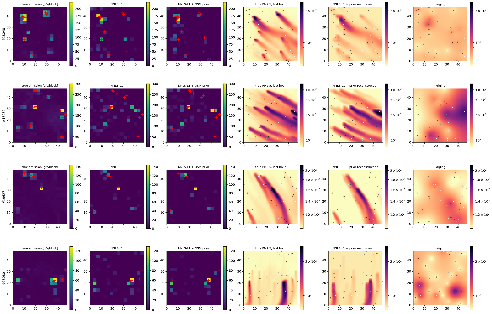

## Phase 4: PINN

Networks for the local excess c'(x, y, t) ≥ 0 (random Fourier features in space-time) and a time-constant
emission density e(x, y) ≥ 0, plus an hourly uniform background. Loss = sensor misfit (hourly means,
noise-weighted) + causally weighted PDE residual (autograd, with the scenario's known divergence-free wind
and mixing height) + inflow BC + source L1. Non-dimensional (L = 48 km, hours, 100 µg/m³).

What made it work: (1) half the collocation points jittered around sensors, otherwise the network
satisfies sensors with spikes that uniform collocation never sees; (2) PDE weight 1000 (at 100 the data
chi²/n fell to 0.18, i.e. it fitted noise); (3) **Morozov early stopping**: stop when data chi²/n reaches 1,
a criterion that never looks at ground truth.

| Scenario | Kriging | IDW | **PINN** | NNLS-L1 + prior (Phase 3) | PINN train time |
|---|---|---|---|---|---|
| #19627 | 12.7 | 13.2 | **11.2** | 7.4 | 1.4 min |
| #18080 | 21.4 | 22.1 | **17.2** | 12.3 | 0.7 min |

Field RMSE [µg/m³] at unseen cells, last hour. The PINN beats physics-free interpolation by 12-20% and
recovers the total emission (826 vs 811 g/s true on #19627, where NNLS gets 477) but smears the source
along the plume axis (an up/downwind degeneracy). It is slower and less accurate than the Green's-function
inversion, which uses the exact discrete operator. Its role in AirTrace is mesh-free, single-scenario
reconstruction; the FNO (Phase 5) is the fast, amortised model.

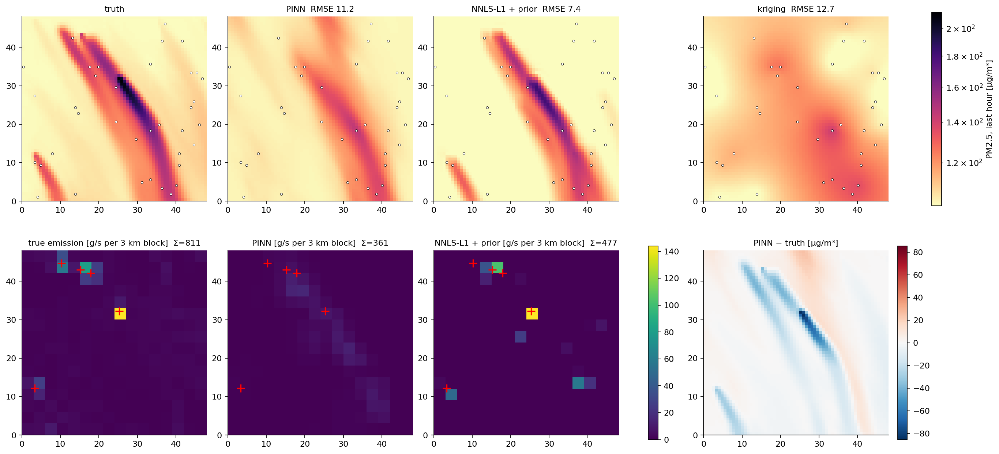
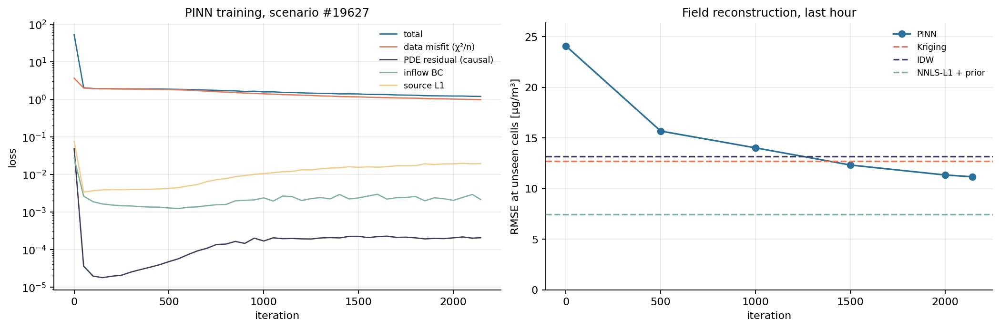

## Phase 5: FNO deep ensemble

A Fourier Neural Operator (4 layers, width 64, 16 modes, zero-padded against wrap-around; ~16M params)
maps 45 input channels (6 h of rasterised sensor readings + masks + IDW interpolations, hourly wind,
mixing height, hour of day, OSM priors, coordinates) to 11 outputs: last-hour source maps per category,
last-hour concentration **per category**, regional background, and c at T and T−1 h. Per-category
concentration targets come from a linear decomposition run (`phase5_contributions.py`), so attribution
is a ratio of predicted fields: no solve at click time. Training: 17k scenarios with **random sensor
networks re-drawn every batch** (5-40 sensors, 5-25% noise, outages), 1k validation, 2k test.
Five members with different seeds; intervals inflated by a factor κ fitted on validation.

Notes from development:
- Adding dense IDW channels and more width cut validation error by ~5% and raised the win rate vs
  kriging from 56% to 70% of scenarios (isolated non-zero pixels are hard for spectral layers).
- The physics-consistency loss (hour-integrated PDE residual of predicted c with predicted S, trapezoid
  in time) is non-zero even for the true fields (RMS ~0.5 vs source RMS ~1.4 in scaled units), so at
  weight 0.1 it blurred outputs; it is kept at 0.02 as a light regulariser.
- The reference decomposition uses the unlimited linear scheme, which undershoots by up to tens of
  µg/m³ at sharp plume edges; contributions are clipped at zero when forming shares.
- The raw ensemble is strongly over-confident (90% intervals cover 38% of field errors, 17% of share
  errors); κ ≈ 4-5 restores nominal coverage on the test set.

### Source and field metrics

| Subset | Method | Precision | Recall | Loc. err [km] | |ΔQ|/Q | Field RMSE [µg/m³] | Rel. RMSE | Local-share err [pp] |
|---|---|---|---|---|---|---|---|---|
| easy | **FNO ensemble** | 0.46 | 0.60 | 3.2 | 0.24 | 20.3 | 0.28 | 10.9 |
| easy | NNLS-L1 | 0.47 | 0.57 | 4.5 | 0.43 | 19.5 | 0.28 | 9.6 |
| easy | NNLS-L1 + OSM prior | 0.51 | 0.62 | 3.2 | 0.31 | 18.7 | 0.27 | 10.4 |
| easy | IDW | – | – | – | – | 22.2 | 0.31 | – |
| easy | Kriging | – | – | – | – | 21.7 | 0.30 | – |
| general | **FNO ensemble** | 0.52 | 0.60 | 3.6 | 0.30 | 32.5 | 0.37 | 12.3 |
| general | NNLS-L1 | 0.48 | 0.52 | 4.5 | 0.47 | 36.0 | 0.40 | 13.1 |
| general | NNLS-L1 + OSM prior | 0.53 | 0.56 | 3.8 | 0.47 | 34.6 | 0.39 | 12.1 |
| general | IDW | – | – | – | – | 34.8 | 0.40 | – |
| general | Kriging | – | – | – | – | 34.4 | 0.39 | – |
| test (n=2000) | **FNO ensemble** | 0.52 | 0.58 | 3.5 | 0.27 | 32.8 | 0.38 | 11.6 |

### Contribution shares (9 receptors per scenario, FNO ensemble)

| traffic | industry | construction | burning | regional | mean |
|---|---|---|---|---|---|
| 8.6 pp | 9.2 pp | 2.4 pp | 6.1 pp | 11.8 pp | 7.6 pp |

### Uncertainty calibration (coverage of nominal 90% intervals, test set)

| Quantity | κ (val) | raw | calibrated |
|---|---|---|---|
| field | 3.93 | 0.38 | 0.90 |
| share | 5.05 | 0.17 | 0.90 |

### Hidden (off-prior) emitters

2652 strong (≥ 15 g/s) off-prior sources in 2000 test scenarios. A 3 km block is flagged when its non-traffic emission has ensemble mean − zσ > 15 g/s and the OSM prior shows no industry, construction or landfill there.

| z | flagged blocks | precision | recall |
|---|---|---|---|
| 0.0 | 337 | 0.18 | 0.02 |
| 1.0 | 82 | 0.23 | 0.01 |
| 2.0 | 20 | 0.05 | 0.00 |

### Inference time per scenario

| Method | Time |
|---|---|
| FNO (1 member, CPU) | 76 ms |
| FNO ensemble (5, CPU) | 361 ms |
| FNO ensemble (5, GPU, batched) | 3 ms |
| NNLS: Green's functions (GPU) | 8.3 s |
| NNLS: solve (CPU) | 410 ms |
| PINN training (GPU) | 86.8 s |
| Kriging (CPU) | 8 ms |

**Reading the results.** On random held-out scenarios the FNO beats every baseline on field error
(32.5 vs 34.4 kriging, 34.6 NNLS + prior), hotspot recall (0.60 vs 0.56) and total-emission error (0.30 vs
0.47) at equal precision, and it degrades far more gracefully with fewer sensors (39.7 vs 45.1 kriging and
52.6 NNLS at 5 sensors) and more noise. On the 30 easy scenarios the Green's-function inversion, which has
the exact physics, is still slightly better on field error (18.7 vs 20.3). The ensemble answers in ~0.4 s on a
laptop CPU (5 members) versus ~8.7 s for NNLS. **Hidden-emitter detection from a single 6 h window is weak**
(recall ≤ 0.02): the network leans on the OSM prior, so off-prior emission is under-predicted.

*Follow-up experiment (not merged).* A dedicated "unknown source" output did not fix this. As an
emission-map regression it collapsed to zero (2% non-zero pixels); as a per-block classifier it reached
precision 0.13 / recall 0.14. Prior-free NNLS finds 43% of hidden emitters but at precision 0.09, and NNLS
with the prior plus residual matched pursuit finds almost none. The emitters are *visible* (in 62% of
scenarios a sensor gets ≥ 30% of its reading from them), but in one 6 h window of near-steady wind a plume
constrains its source only to a line upwind, and a mapped source on that line explains it equally well. The
physically sound remedy is to combine windows with different wind directions so the lines intersect.

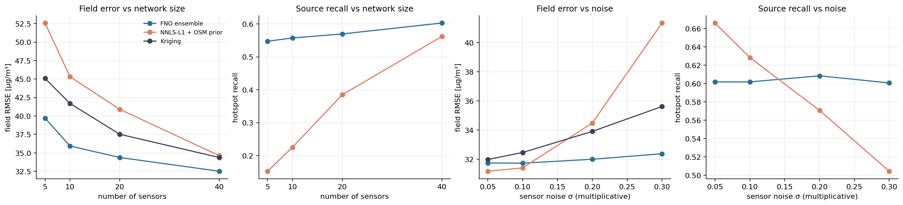
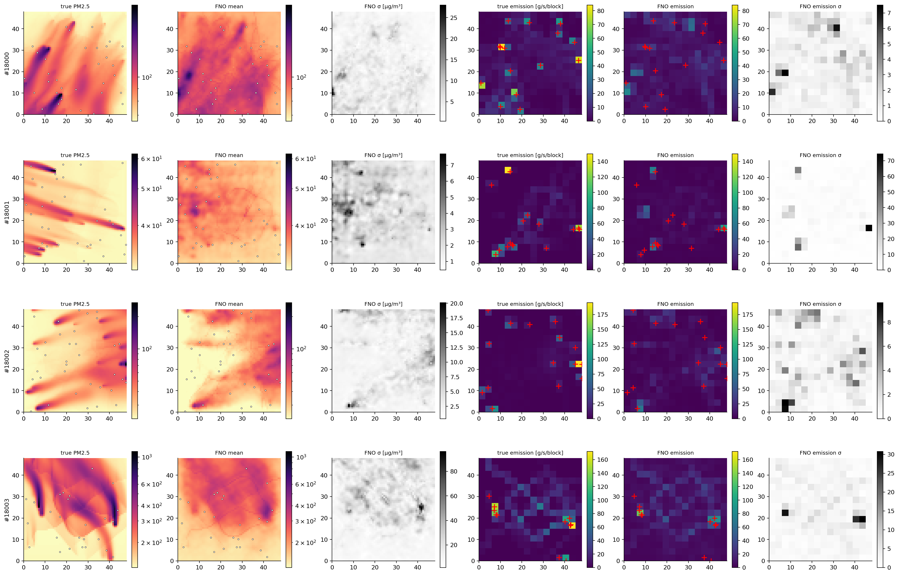
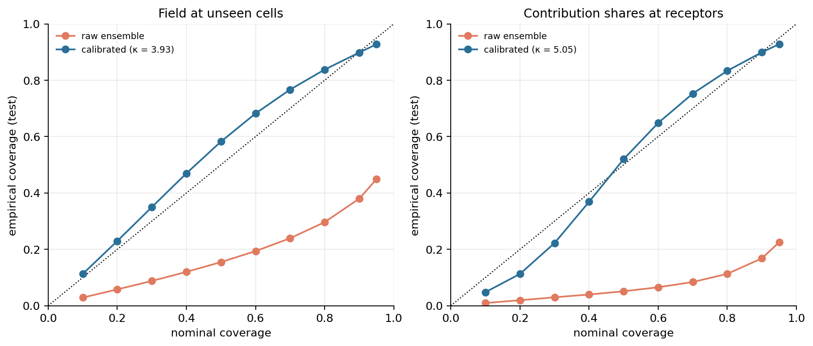
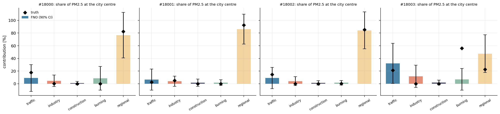

## Phase 6: real Delhi data (first model, trained on synth_v1)

**Data.** Hourly PM2.5 from the OpenAQ v3 API for every reference monitor in the 48 km box (CPCB, DPCC,
IMD, UPPCB, HSPCB, US Embassy): 128 sensor records, merged to **51 stations** (co-located
duplicates within 300 m keep the most complete record; ≥ 50% coverage required), quality-controlled
(non-positive, > 1500 µg/m³ and ≥ 6 h frozen runs removed). Period **1-30 November 2025** (post-monsoon
smog season; OpenAQ re-registered most Delhi monitors as new sensors in Feb 2025, so earlier years are
sparse). 90% of station-hours are valid; median 192 µg/m³, 95th percentile 429. Meteorology is ERA5 via
the Open-Meteo archive (no key): 100 m wind and boundary-layer height averaged over a 3×3 grid of points.
Indian monitors report IST clock hours (hh:30 UTC), so each station hour is paired with the reanalysis at
its midpoint. All responses are cached in `artifacts/cache/` (2.4 MB), so the pipeline and demo run offline.
The key is read from `$OPENAQ_API_KEY` or a git-ignored `.openaq_key` file and never stored elsewhere.

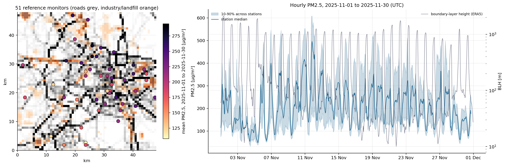

**Leave-one-station-out validation.** Every 3 h (229 windows), each station with a valid reading
is removed together with any station in the same 750 m cell, and its last-hour PM2.5 is predicted from the
other stations (11023 predictions). *FNO + residual kriging* adds the kriged misfit of the FNO
field at the remaining stations (regression kriging), which uses no information from the held-out station.

| Method | RMSE [µg/m³] | MAE | Bias | r | RMSE night (20-08 IST) | RMSE day (08-20) |
|---|---|---|---|---|---|---|
| **FNO ensemble** | 84.8 | 59.7 | -13.0 | 0.66 | 93.6 | 74.9 |
| **FNO + residual kriging** | 80.9 | 54.2 | +4.3 | 0.70 | 91.3 | 68.7 |
| Kriging | 75.8 | 49.9 | -0.8 | 0.73 | 85.7 | 64.2 |
| IDW | 77.9 | 51.5 | -3.0 | 0.72 | 87.9 | 66.2 |
| Network median | 81.7 | 56.3 | -0.4 | 0.68 | 92.7 | 68.9 |

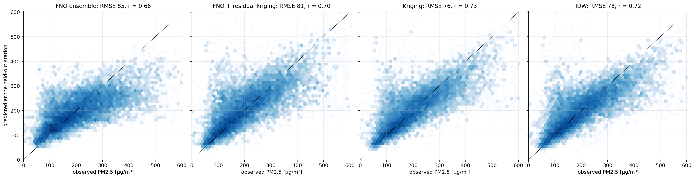
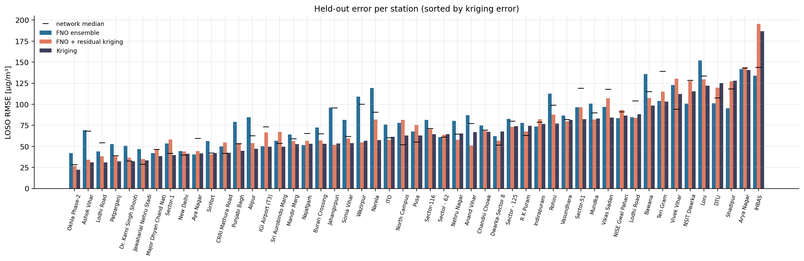
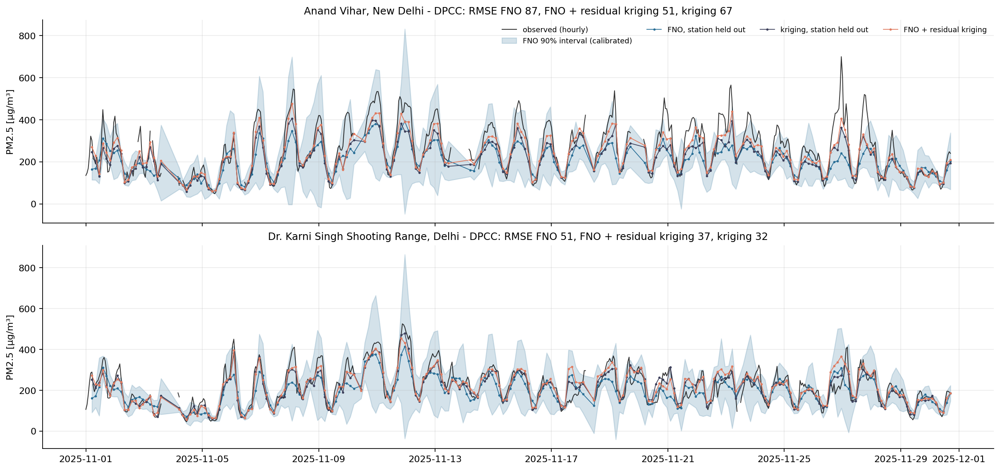

**Reading the results honestly.** On real data the synthetic-trained FNO does **not** beat kriging: it is
worse than kriging and about as good as predicting the network median, and it is biased low by 13 µg/m³.
Regression kriging removes the bias and recovers part of the gap (80.9
vs 75.8); it beats kriging at 29% of
stations. Reasons, in order of likely importance:

1. **Representativeness.** Even the best method only improves on the network median by ~7%. Much of the
   station-to-station difference is hyper-local (a monitor 20 m from a bus depot, a persistent offset such as
   IHBAS reading ~80 when its neighbours read 300) and is not predictable from other stations or from a 750 m model.
2. **Out-of-distribution meteorology.** ERA5 puts the winter night boundary layer at 12-80 m; training spanned
   175-1560 m, so H was clipped in 68% of hours (wind speed in
   10%). The model therefore sees far deeper mixing than reality at night,
   which is consistent with its low bias.
3. **Simplified emissions and chemistry.** No secondary aerosol formation, no transboundary plumes from Punjab
   and Haryana crop burning, a uniform background and synthetic emission magnitudes.
4. **Uncertainty is miscalibrated off-distribution.** The synthetic-data κ = 3.93
   gives 72% coverage of nominal 90% intervals, not 90%.

**Source shares on real data (full network, mean at the monitors):** traffic 11%,
industry 5%, construction 1%, burning 2%,
regional 80%. A dominant regional/background share agrees qualitatively with Delhi
source-apportionment studies, which attribute most of winter PM2.5 to secondary and transported aerosol; but
here "regional" is whatever the model cannot explain locally, and the clipped (too deep) mixing height
shrinks local contributions, so **these numbers are illustrative, not an inventory**.

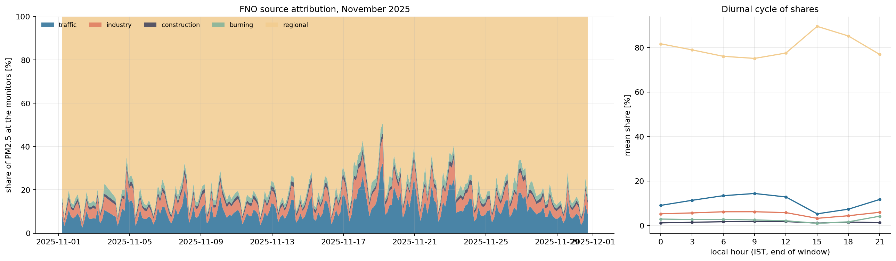

Next steps that would address the gap (not done): regenerate training data with mixing heights down to
~20 m and stronger regional variability; fine-tune on real windows with leave-station-out objectives; or use
the FNO as the drift term in regression kriging, as above, which is the most robust option today.

## Sim-to-real fix: synth_v2

The diagnosis above led to a second dataset and a retrained ensemble (`configs/default.yaml`):

- **Real meteorology:** 30 h segments of ERA5 100 m wind and boundary-layer height from Oct-Dec 2019-2024,
  with small rotation and speed jitter. November 2025 (test) and December 2025 (calibration) are excluded.
- **Entrainment:** a deepening mixed layer dilutes the local excess at rate max(d ln H/dt, 0), with the regional
  term adjusted so that a uniform background c_bg(t) stays an exact solution (tested). This exposed a lag in the
  forcing, now fixed: the background is evaluated at the middle of each 10 min step, not held at its hourly value.
- **Monitor error model:** a persistent per-sensor log offset plus AR(1) hourly error (ρ = 0.7), measured from real
  station residuals (offset log s.d. 0.19, hourly 0.34).
- **Calibration on December 2025 only** (`scripts/phase6_calibrate.py`):

| | Network median p10 / p50 / p90 [µg/m³] | Station spread | Night/day | Hourly change |
|---|---|---|---|---|
| Real, Dec 2025 | 110 / 200 / 325 | 0.68 | 1.26 | 0.05 |
| synth_v2 | 112 / 198 / 326 | 0.69 | 1.30 | 0.04 |

Matching the night/day ratio required an **effective mixing depth floor of 150 m**, a calibrated parameter: with raw
ERA5 nights (~30 m) the simulator doubles night-time PM2.5. It applies in 63% of real hours.

**Result on the untouched test month** (leave-one-station-out, November 2025; kriging: RMSE 75.8, bias -0.8, r = 0.73):

| Method | RMSE v1 | RMSE v2 | Bias v1 | Bias v2 | r v1 | r v2 |
|---|---|---|---|---|---|---|
| FNO ensemble | 84.8 | 82.9 | -13.0 | +3.4 | 0.66 | 0.67 |
| FNO + residual kriging | 80.9 | 81.0 | +4.3 | -0.5 | 0.70 | 0.69 |

**The simulator now matches real statistics, but this did not close the gap.** The FNO's bias is gone and its RMSE improved
slightly, but it still loses to kriging at station-level prediction, is about level with the network median
(81.7), and residual kriging gained nothing. It beats kriging at
22% of stations. Uncertainty got worse: nominal 90% intervals cover
54% of held-out readings (v1: 72%), so **ensemble
intervals are not trustworthy on real data**, though they remain calibrated on synthetic data.

Mean shares at the monitors: regional 84%, traffic 9%, industry
5%, burning 2%, construction 0%. There is **no ground truth
for these on real data**: held-out stations test total PM2.5 only, not the split between sources. Their dominant regional share also partly
reflects the calibration, which fixes the background level. Treat them as model output, not an inventory.

On held-out synth_v2 scenarios (n = 2000): hotspot precision 0.51, recall 0.68, localisation
3.2 km, field RMSE 33.8 µg/m³, mean share error 4.1 pp. These are not comparable with the
synth_v1 table (a different, background-dominated problem) and have no baselines on synth_v2. Hidden-emitter recall stays ≤ 0.01.

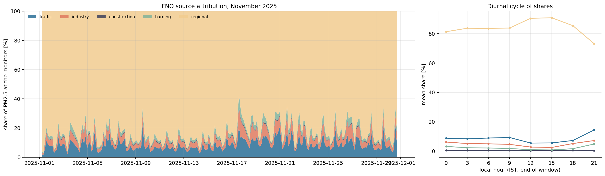
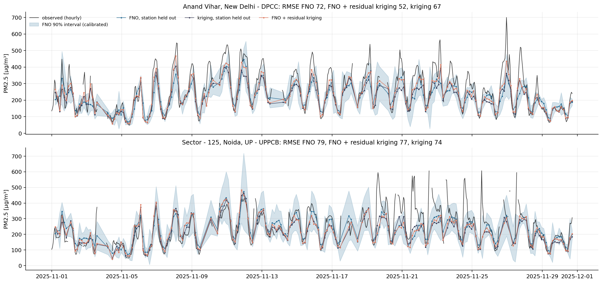

## Phase 7: web app

A React and Node app with a Python model service. It runs on a laptop CPU and needs no network once built.

```bash
.venv/Scripts/python scripts/phase7_hidden.py --trials 10 --nights 5   # ~1-2 h
.venv/Scripts/python scripts/phase7_precompute.py                      # builds app/data
npm --prefix app install
npm --prefix app start                                                 # http://localhost:3000
npm --prefix app test
```

Screens: **Live map** (real November 2025: kriging for PM2.5, labelled FNO source estimates), **Scenario lab** (simulated cities
with the truth shown: sensors, noise, custom layouts, a wind what-if), **Hidden emitter**, **Evidence** and **How it works**.

**Priority list, tested where the truth is known** (top-5 blocks within one block of a true source ≥ 15 g/s, 600 held-out synth_v2
scenarios, domain-edge blocks excluded): FNO ranking 63%, OSM map alone 61%, random 29%. So it adds little
beyond the map from a single window. Its Gaussian probabilities are overconfident, so the lab shows measured hit rates and the
real-data list shows a ranking only. It is unvalidated on real data, and blocks are described relative to public monitors, not businesses.

**Hidden emitter: do changing winds locate an unmapped night-only source?** Prior-free NNLS, real monitor cells, consecutive
20:00-02:00 windows of ERA5 weather, matched controls without the source, 10 trials (strong sources, 30-80 g/s daily mean):

| Nights combined | Median error | Top block within one block | Top score beats control |
|---|---|---|---|
| 1 | 20.2 km | 20% | 63% |
| 2 | 17.2 km | 30% | 66% |
| 3 | 12.0 km | 30% | 74% |
| 5 | 6.6 km | 50% | 66% |

Chance of a hit for a random block: about 6%. Localisation improves with more nights, which supports the idea, but 10 trials is
few (5 of 10 has a wide interval), and the sources are strong. The score separates hidden from control only weakly and doesn't
improve steadily, so this can suggest where to look but not whether a source is there. This used physics inversion, not the FNO.
