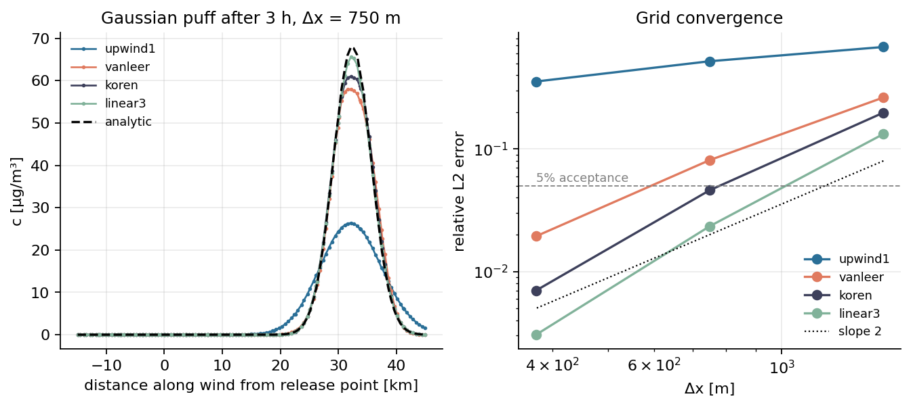
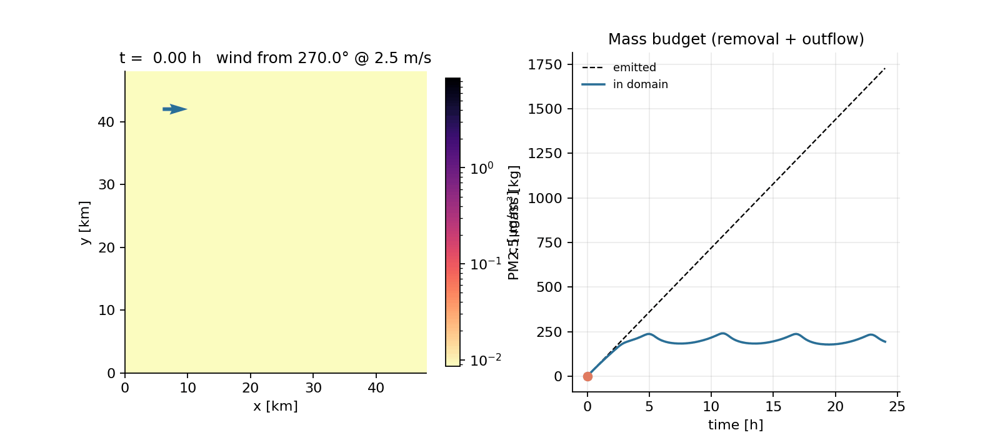
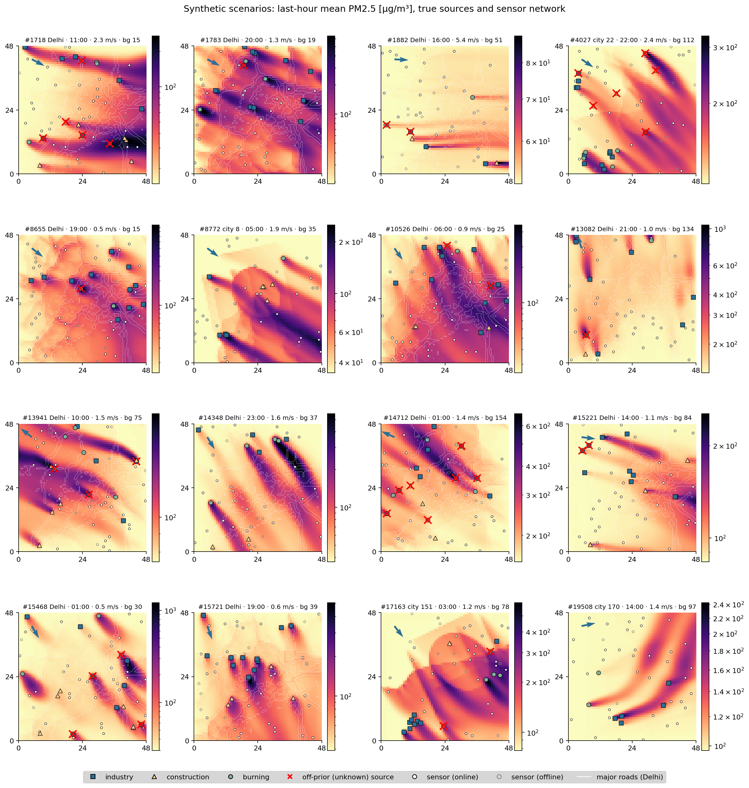

# AirTrace

Physics-informed PM2.5 source attribution from sparse sensors (Delhi NCR prototype).

> Work in progress. Phases 1-2 (solver, synthetic data) are complete; the full README with results lands in Phase 8.

## Setup

```bash
python -m venv .venv --system-site-packages
.venv/Scripts/python -m pip install -e .   # Linux/macOS: .venv/bin/python
.venv/Scripts/python -m pytest
.venv/Scripts/python scripts/phase1_solver.py
.venv/Scripts/python scripts/phase2_generate.py   # ~20 min on a laptop GPU, 2 GB
.venv/Scripts/python scripts/phase2_figures.py
```

## Phase 1: forward solver

Flux-form finite-volume solver for `∂c/∂t + ∇·(uc) = ∇·(K∇c) − λc + S` on a 48 × 48 km, 64 × 64 grid
(`src/airtrace/solver/`). Koren-limited MUSCL advection (TVD, positive), central diffusion, SSP-RK3,
inflow-Dirichlet / outflow zero-gradient boundaries, batched in PyTorch (CPU or GPU).

| Gaussian puff, 3 h, rel. L2 error | 1500 m | 750 m | 375 m |
|---|---|---|---|
| 1st-order upwind | 68.1% | 52.1% | 35.6% |
| van Leer | 26.4% | 8.1% | 1.9% |
| **Koren (default)** | 19.8% | **4.6%** | 0.7% |
| linear κ=1/3 (for Green's functions) | 13.3% | 2.3% | 0.3% |




## Phase 2: synthetic dataset

20,000 scenarios (`src/airtrace/data/`), each a 30 h simulation (24 h spin-up + 6 h observation window):

- **Geography:** 70% on real Delhi priors rasterised from OpenStreetMap (major roads, industrial,
  construction/brownfield, landfill/farmland; cached in `artifacts/cache/osm`), 30% on 256 random synthetic cities.
- **Sources:** traffic line sources along roads (rush hours + night truck window), 3-12 industrial clusters,
  0-6 construction sites (daytime), 0-5 burning sites (landfill / evening). 15% of discrete sources are placed
  where the prior shows nothing; half of the off-prior industry emits only at night (hidden emitters).
- **Meteorology:** hourly wind with a NW-sector bias, diurnal speed cycle and a divergence-free spatial
  perturbation; diurnal mixing height converts emissions to S = E / (H dx dy).
- **Regional background:** inflow BC plus a uniform term λ c_bg + dc_bg/dt, so a uniform c_bg(t) is an exact
  solution (removal acts on the local excess only).
- **Sensors:** 40 cells ≥ 1.5 km apart, 10-20% lognormal noise, 0-30% offline, 5% hourly gaps
  (training re-samples networks on the fly).
- **Exact re-simulation:** every scenario is stored with its compact spec (wind, background, inventory) so it can
  be re-run, e.g. for Green's functions.


